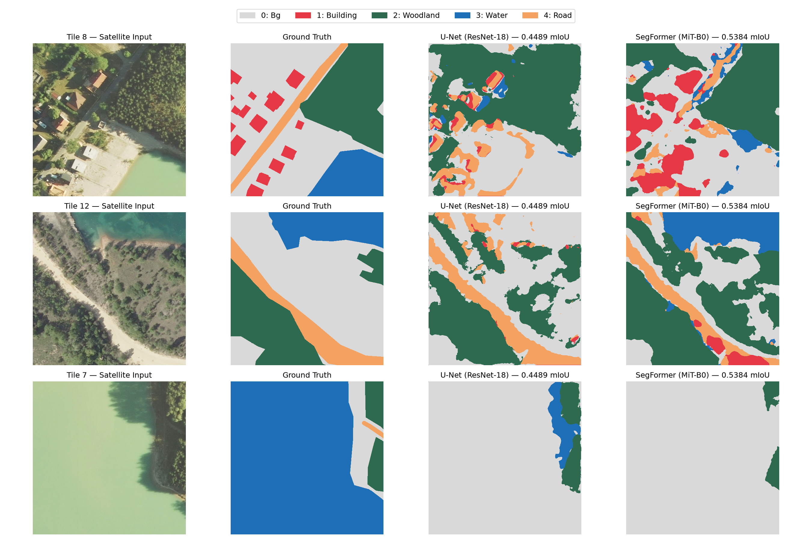

# Satellite Imagery Semantic Segmentation (U-Net vs. SegFormer)

End-to-end 5-class semantic segmentation pipeline on aerial satellite imagery (`LandCoverAI100`), iteratively engineered and benchmarked locally on Apple Silicon (M1 MPS) using **PyTorch**, **TorchGeo**, and **`segmentation-models-pytorch`**.


*Side-by-side predictions on the three most class-diverse validation tiles (`0: Bg`, `1: Building`, `2: Woodland`, `3: Water`, `4: Road`).*

---

## Dataset & Exploratory Audit

This project uses **`LandCoverAI100`** (loaded via `torchgeo.datasets.LandCoverAI100`), a 100-tile $512 \times 512$ benchmark subset of the Polish **LandCover.ai** high-resolution aerial dataset covering five land-cover classes.

Auditing pixel frequencies across the `train` (70 tiles) and `val` (15 tiles) splits revealed severe class imbalance and a **6× distribution shift** on water:

| Split | Tiles | Background | Building | Woodland | Water | Road |
| :--- | :---: | :---: | :---: | :---: | :---: | :---: |
| **Train** | 70 | 63.43% | 1.27% | 29.23% | 4.02% | 2.05% |
| **Validation** | 15 | 51.82% | 1.05% | 21.05% | 24.11% | 1.97% |

Because `Background` and `Woodland` make up >92% of training pixels, standard **Pixel Accuracy** masked complete failures on minority classes—making per-class **IoU** and **mIoU** essential for evaluation.

---

## Models & Training Pipeline

Two distinct computer vision encoder-decoder architectures were fine-tuned from ImageNet-1K pretrained weights (`smp-hub`):

* **U-Net (`resnet18` encoder, ~14.3M params):** Classic CNN encoder-decoder with skip connections for fine local texture recovery.
* **SegFormer (`mit_b0` encoder, ~3.7M params):** Hierarchical Vision Transformer using global self-attention and a lightweight multi-scale MLP decoder.

**Training Recipe:**
* **Augmentations & Normalization:** 8× geometric transforms (random horizontal/vertical flips and 90° rotations on `train`) paired with ImageNet mean/std normalization.
* **Loss Function:** 50/50 hybrid **Class-Weighted Cross-Entropy** (`[0.5, 3.0, 1.0, 2.5, 2.5]`) + **Multiclass Dice Loss** to penalize missed minority pixels while optimizing region overlap.
* **Optimization:** Cosine Annealing LR schedule over 20 epochs (`Adam` at `1e-3` for U-Net; `AdamW` at `3e-4` with `1e-2` weight decay for SegFormer) with best-validation-mIoU checkpointing.

---

## Iterative Experiment Log

Every upgrade was driven by a specific failure mode identified in validation metrics or visual mask inspections:

| Run | Model & Key Change | Epochs | Best Val mIoU | Bg | Building | Woodland | Water | Road |
| :--- | :--- | :---: | :---: | :---: | :---: | :---: | :---: | :---: |
| **1** | U-Net (`resnet18`) + CE/Dice + Best Checkpoint | 15 | `0.3467` | — | — | — | — | — |
| **2** | + 8× Flips/Rotations + ImageNet Normalization | 20 | `0.3570` | `0.5901` | `0.1856` | `0.7067` | `0.0000` | `0.3023` |
| **3** | + Class Weights `[0.5, 3.0, 1.0, 2.5, 2.5]` | 20 | `0.4489` | `0.6099` | `0.2351` | `0.7076` | `0.3563` | `0.3357` |
| **4** | **SegFormer (`mit_b0`) + Weighted CE/Dice + AdamW** | **20** | **`0.5384`** | **`0.6571`** | **`0.3920`** | **`0.7801`** | **`0.4004`** | **`0.4624`** |

### Key Takeaways
1. **Augmentation & Normalization (Run 1 → 2):** Multiplying the 70 training tiles by 8× reduced overfitting and woke up `Building` detection (`0.1856`), while per-class logging isolated `Water: 0.0000` as the main bottleneck.
2. **Class Weighting (Run 2 → 3):** Because water pixels were clustered into just a few training tiles and visually resembled flat fields, unweighted Cross-Entropy defaulted to `Bg`. Weighting minority classes revived `Water` (`0.0000` → `0.3563`) and improved all five classes simultaneously (`+0.0919` mIoU).
3. **CNN vs. Vision Transformer (Run 3 → 4):** SegFormer (`mit_b0`) outperformed U-Net across every class (**`0.5384`** vs. `0.4489` mIoU) with ~4× fewer parameters, leveraging global self-attention to sharply improve **Buildings (`+0.1569`)** and continuous **Roads (`+0.1267`)**.

---

## Qualitative Error Analysis

Inspecting `comparison.png` highlights both architectural differences and real-world dataset nuances:
* **Small-Object & Global Context Recovery:** In **Tile 8**, SegFormer resolves dense building footprints far more cleanly than U-Net; in **Tile 7**, SegFormer recovers the right-hand lake that U-Net missed completely.
* **Ground Truth Polygon Granularity:** In **Tile 12**, human polygon annotations label only dense forest stands as `Woodland`, leaving isolated trees and shrubs in the central open strip labeled as `Background`. Both models accurately detect several of these scattered tree clumps, which `MulticlassJaccardIndex` counts as false positives—meaning visual predictions on sparse vegetation actually exceed label granularity.

---

## Repository Structure

```text
satellite-seg/
├── train_Unet.py                  # U-Net (ResNet-18) training, per-class IoU & plotting
├── train_segformer.py        # SegFormer (MiT-B0) training, per-class IoU & plotting
├── compare.py                # 4-column side-by-side comparison plot generator
├── comparison.png            # Hero visual comparing Ground Truth, U-Net & SegFormer
├── prediction.png            # U-Net best-epoch validation predictions
├── prediction_segformer.png  # SegFormer best-epoch validation predictions
├── requirements.txt          # Core Python dependencies
└── .gitignore                # Excludes venv/, data/, and *.pth checkpoints
```
---

## Quick Start

1. **Clone the repository and set up the environment:**
   `git clone [https://github.com/]https://github.com/swastiksinghdun/satellite-seg.git`
   `cd satellite-seg`
   `python -m venv venv && source venv/bin/activate`
   `pip install -r requirements.txt`

2. **(macOS only) Configure SSL certificates for weight/dataset downloads:**
   `export SSL_CERT_FILE=$(python -m certifi)`
   `export REQUESTS_CA_BUNDLE=$(python -m certifi)`

3. **Run training and generate the comparison plot:**
   `python train_Unet.py` — trains U-Net baseline (`unet_best.pth`, `prediction.png`)
   `python train_segformer.py` — trains SegFormer (`segformer_best.pth`, `prediction_segformer.png`)
   `python compare.py` — generates the 4-column comparison grid (`comparison.png`)

---

## Future Roadmap

* **Full-Scale Dataset Training:** Scale `train_segformer.py` to the full ~10,600-tile `LandCoverAI` dataset on a cloud GPU (T4/A100) with larger batch sizes.
* **Backbone Scaling:** Benchmark `mit_b2` and `resnet34` encoders to measure accuracy vs. compute trade-offs.
* **Large-Scene Inference:** Add sliding-window patch inference with overlap blending to segment full multi-megapixel aerial orthophotos.